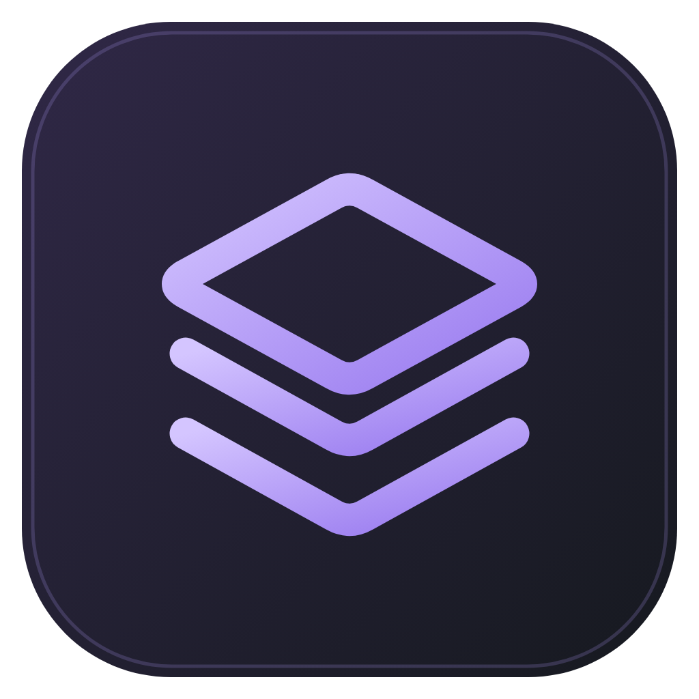
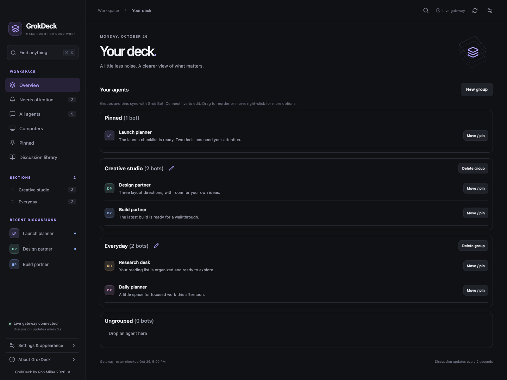
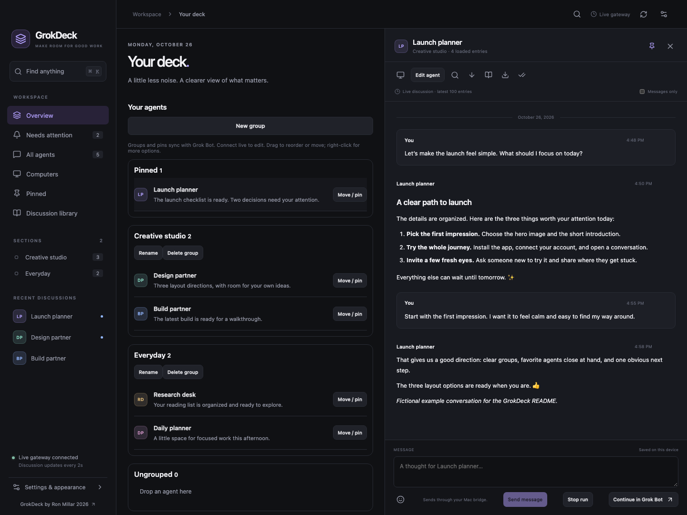
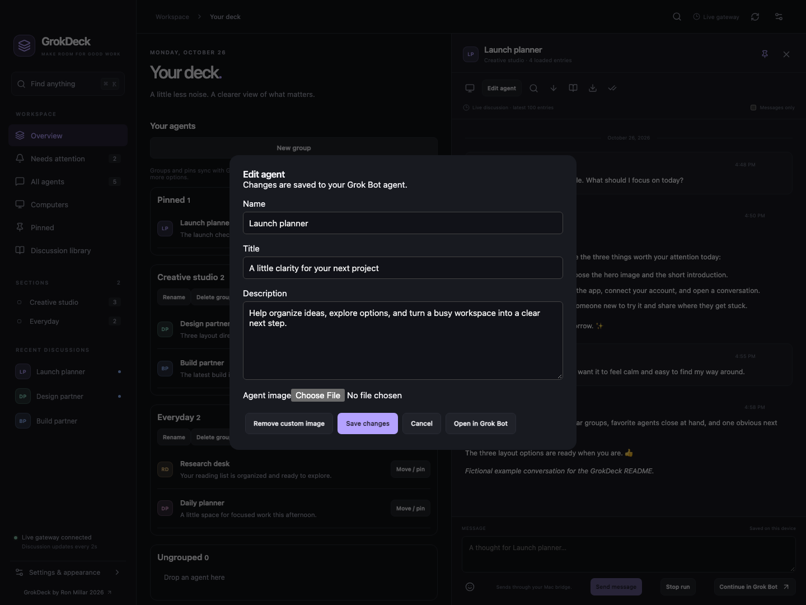
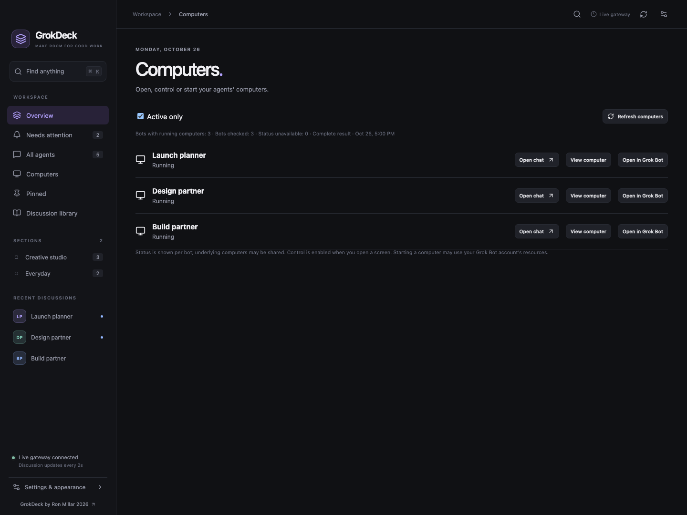
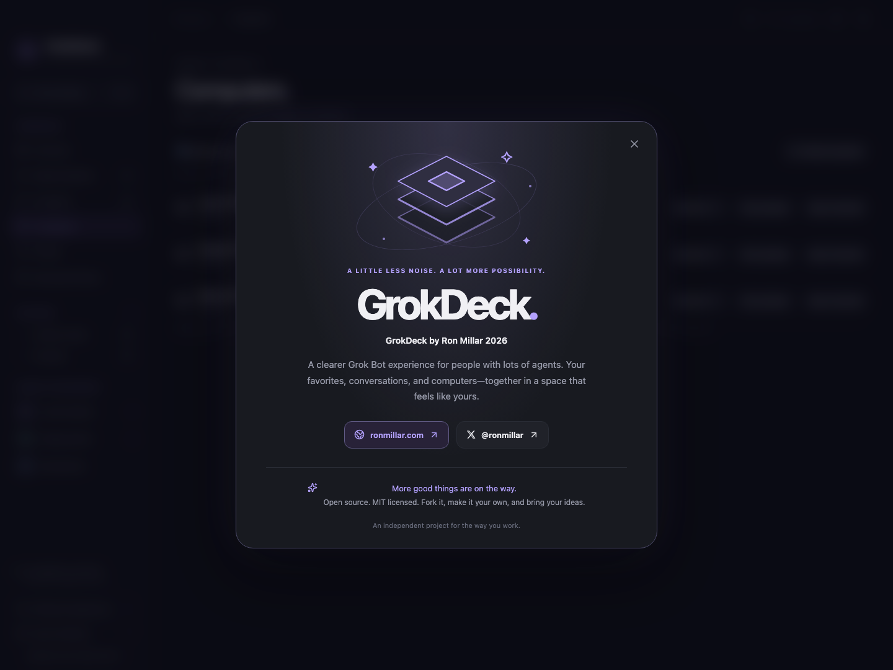

<p align="center"></p>

# GrokDeck

### A clearer Grok Bot experience, built for people with lots of agents.

When your agent list grows, finding the right conversation should stay simple. GrokDeck is an independent front end for Grok Bot that puts favorites, groups, conversations, and agent computers in one organized workspace. Spend less time finding your way around and more time working with your agents.

**GrokDeck by [Ron Millar](https://ronmillar.com) 2026.** Open source. MIT licensed. Bring your own Grok Bot account.

[](https://github.com/Gamedesigner/grokdeck/actions/workflows/build.yml)
[](https://github.com/Gamedesigner/grokdeck/actions/workflows/ios.yml)
[](LICENSE)

[Download](#download) · [Get started](#get-started) · [Connect your iPhone](#connect-your-iphone) · [Make it your own](#make-it-your-own)



*Screenshots show the real desktop interface with fictional example agents and conversations. They contain no personal account data. Source screenshots include the latest changes; older installers may look different.*

## Built for a growing agent workspace

| When you have lots of agents… | GrokDeck helps you… |
| --- | --- |
| Favorites get lost in the list | Keep pinned agents at the top of Overview. |
| Projects and everyday work mix together | Organize agents into groups that stay in sync with Grok Bot. |
| The list needs rearranging | Drag agents within or between groups, or right-click to move and pin them. |
| You need the right agent quickly | Sort All agents by activity, name, or group; filter by status or group; search agents and cached conversations. |
| You want to pick up a discussion | Read and send messages, reply to a message, use emoji, and keep a local draft. |
| You need an agent’s computer | See running computers together, open a screen, and use its mouse and keyboard. |
| You want a workspace that feels like yours | Edit agent names, descriptions, and images; choose your theme, accent, text size, and density. |

Groups and pins are shared with Grok Bot. Notes, drafts, and appearance preferences stay local to GrokDeck. Deleting a group keeps its agents.

Click the pencil beside a section heading in Overview or its section page to rename it. You can also double-click the section name in the sidebar. Counts read **System (3 bots)**, and confirmed name changes appear in Grok Bot too.

## Download

**Current preview: [GrokDeck 0.3.0-rc.5 for Mac and Windows](https://github.com/Gamedesigner/grokdeck/releases/tag/v0.3.0-rc.5).** Adds in-app GitHub updates, Grok Bot 0.77.0 compatibility, and workspace refresh recovery. Includes clearer bot counts, rename pencils, sidebar double-click renaming, purple section headings, and an animated About splash. Windows uses ronmillar.com package branding and contains no personal signing certificate.

| Device | Download / install | Status |
| --- | --- | --- |
| Mac with Apple silicon | [arm64 DMG](https://github.com/Gamedesigner/grokdeck/releases/download/v0.3.0-rc.5/GrokDeck-0.3.0-rc.5-mac-arm64.dmg) | Developer ID signed and notarized |
| Mac with Intel | [x64 DMG](https://github.com/Gamedesigner/grokdeck/releases/download/v0.3.0-rc.5/GrokDeck-0.3.0-rc.5-mac-x64.dmg) | Signed and notarized; exercised under Rosetta, separate Intel hardware check pending |
| Windows PC, x64 | [Windows installer](https://github.com/Gamedesigner/grokdeck/releases/download/v0.3.0-rc.5/GrokDeck-0.3.0-rc.5-win-x64.exe) | Unsigned preview; Windows shows Unknown publisher and may warn or block installation |
| iPhone / iPad | [Build with Xcode](docs/ios-prototype.md#current-preview) | iPhone tested; no public TestFlight or App Store download yet |

[All releases](https://github.com/Gamedesigner/grokdeck/releases) · [Checksums](https://github.com/Gamedesigner/grokdeck/releases/download/v0.3.0-rc.5/SHA256SUMS.txt)

**Install this preview manually once if you have an older preview.** After that, use **Settings → GrokDeck updates → Check GrokDeck updates**, download the offered version, then choose **Install update** on Windows or **Restart and install** on Mac. Windows opens its normal installer. Preview builds follow newer previews and stable releases; stable builds stay on stable releases. GitHub’s “Latest” badge still points to stable **0.2.5**. Public downloads do not require a GitHub account. [Update details](docs/app-updates.md).

## Get started

1. **Open Grok Bot on your Mac or Windows PC** and sign in to your own account.
2. **Install GrokDeck on the same computer.** On Mac, open the DMG and drag GrokDeck into Applications. On Windows, run the installer. Quit an older GrokDeck before installing a newer one.
3. **Launch GrokDeck.** It starts its included helper and connects automatically. Allow the OS secure-storage prompt if it appears. No separate GrokBridge download, Node.js installation, or terminal command is needed.
4. **Check your agents, then organize your workspace.** Open Overview for groups and favorites, All agents for sorting and filtering, or Computers for remote desktops.

Each person connects to their own Grok Bot installation. GrokDeck does not ask you to paste a Grok Bot password or session token. Windows GrokDeck uses the signed-in Windows installation; Mac GrokDeck uses the signed-in Mac installation.



### Customize your agents

Open an agent’s conversation and choose **Edit agent** in its toolbar. Change its name, title, description, or image, then choose **Save changes**. Supported image inputs are PNG, JPEG, and WebP under 5 MB. These edits update the agent in Grok Bot.



### Open an agent computer

Choose **Computers → View computer** for a running agent, or use the computer button in a conversation. Mouse and keyboard control starts enabled; turn **Control** off to watch without interacting. Use full screen for more room.

Turn off **Active only** to see sleeping or unstarted computers. **Start computer** explicitly starts or resumes a computer and may use your Grok Bot account’s resources. If a screen fails to load, **Open in Grok Bot** opens the agent so you can continue there. “Running” status does not guarantee that its screen endpoint is available.



### Meet the maker

**About GrokDeck** near the bottom of the sidebar opens an animated splash with links to [Ron’s website](https://ronmillar.com) and [@ronmillar on X](https://x.com/ronmillar). It follows your theme and respects reduced-motion settings.



## Connect your iPhone

The iPhone app uses your paired desktop helper. Installing Grok Bot on the phone does not replace that helper.

1. [Install the iPhone build using Xcode](docs/ios-prototype.md#current-preview). Xcode requires a Mac; the helper you subsequently pair with can run on Mac or Windows.
2. Put the iPhone and desktop on the **same trusted local network**. Wi-Fi on the phone and Ethernet on the desktop is fine. Guest Wi-Fi may block device-to-device access.
3. In desktop **Settings → Connect your iPhone**, select your private network address and choose **Start phone connection**, then **Copy phone setup**.
4. In iPhone **Settings → Quick pairing**, paste the one-time setup within five minutes. Allow **Local Network** access when iOS asks.
5. Keep the desktop awake and GrokDeck open. Your agent list should appear on the phone.

The setup invitation expires and can be used only once. Create a fresh one if needed. Never share it or include it in a screenshot or issue.

On iPhone, conversations open at the latest message, the composer sits at the bottom, and tapping the conversation dismisses the keyboard. Computers open full screen and support landscape, touch, and typing. **Open in Grok Bot** is available as a fallback; it requires Grok Bot to be installed on the phone.

**Away from home?** Cellular and another Wi-Fi network cannot reach the current local pairing by themselves. A remote-access option is planned; no VPN, public relay, or router port forwarding is configured by GrokDeck today.

## Troubleshooting

| What you see | What to try |
| --- | --- |
| Cached view / Retry connection | Open Grok Bot on the same computer and confirm you are signed in. Install the current preview, then relaunch GrokDeck. |
| Windows opens an older version | Quit the old app, install the new EXE, then check **Settings → Version & compatibility**. |
| A custom data folder never connects live | Select **Settings → Grok Bot connection → Use default** to return to the same computer’s installation. Copied caches remain snapshots. |
| iPhone cannot connect | Keep the host awake, check Local Network permission and the trusted network, and copy fresh phone setup if the address changed. |
| Computer says Running but the viewer fails | Try **Open in Grok Bot**. Some vendor screen endpoints can fail independently of status. |
| A save could not be confirmed | Reopen the agent or groups and check the current state before retrying. A multi-part save can partially succeed. |
| A new Grok Bot version is unsupported | Check for a GrokDeck update. A release announcement does not establish protocol compatibility. |

Default data folders: `~/Library/Application Support/Grok Bot` on Mac and `%APPDATA%\Grok Bot` on Windows. If your cache lives elsewhere, use **Settings → Grok Bot connection → Choose folder**. A custom folder does not silently authorize a live connection to another account.

## Preview boundaries

- GrokDeck is an independent project, not an official Grok Bot client. Its integration uses observed, version-specific interfaces. The source adapter allows Grok Bot **0.75.0, 0.75.8, and 0.77.0**. [The 0.77.0 review](docs/compatibility-0.77.0.md) includes static checks across Windows and both Mac architectures plus live Mac reads; an upstream update may require adapter work.
- Mac real-account access, shared group changes, a profile-title edit, and a desktop screen have been exercised. Physical iPhone pairing, viewer controls, landscape, and selected-agent fallback have been confirmed.
- Windows 0.3.0-rc.5 checks cover unsigned app/installer/uninstaller status, website company metadata, bundled signing identities, updater configuration, installation, installed-app security, and uninstall on a disposable CI runner. Renderer checks and a separate-profile secure-storage fixture also pass in CI. Real-account operation and a manual upgrade from the withdrawn signed preview remain separate device checks. Custom-image upload has validation coverage but still needs a real-account check.
- Attachments, approvals, broader agent permissions, billing, and other unsupported actions remain in Grok Bot. The current editor covers name, title, description, and image.
- Viewer sessions are bounded and expire; reopen a viewer to reconnect. Group updates on Grok Bot 0.77.0 use its cloud settings with conflict detection; the older 0.75 adapters use two vendor stores and are not atomic. [Implementation and verification details](docs/desktop-agent-tools.md).

## Privacy and security

GrokDeck has no analytics or hosted account service. Its desktop helper reads the signed-in account through OS-protected storage, keeps decrypted Grok Bot credentials in memory, and sends them only to the validated vendor endpoints needed for the requested operation. The iPhone receives a separate GrokDeck pairing credential stored in its Keychain, not your Grok Bot session.

Desktop and phone connections use authenticated HTTPS with certificate pinning. Phone hosting listens on one selected private network address. Groups, pins, profile edits, and messages you choose to save or send go to your Grok Bot account. Optional update checks contact GitHub and Grok Bot’s update service without conversation content. Exported discussions and clipboard contents can contain private information.

See [security reporting](SECURITY.md), [the security upgrade](docs/security-upgrade-0.2.3.md), and [release/update behavior](docs/app-updates.md). Do not put credentials, setup invitations, private conversations, or sensitive desktop screenshots in public issues.

## Make it your own

**More updates are on the way—and you don’t have to wait for us.** Fork this repo, build the Grok Bot interface you want, and share what you make. GrokDeck is MIT licensed; you can reuse and modify it with the license notice retained.

Ideas, bug reports, UX feedback, and pull requests are welcome. If GrokDeck helps you manage your agents, a star or a link helps others find it.

Areas we want to improve next:

- Easier iPhone installation and pairing.
- A secure way to connect away from home.
- More Grok Bot actions and richer conversation content.
- A smoother upgrade path and more real-device compatibility checks.
- Better ways to keep large agent workspaces organized.

These are directions, not release-date promises. See the [roadmap](docs/roadmap.md) and [contribution guide](CONTRIBUTING.md).

### Run from source

Use Node.js 24 and npm, plus the signed-in Grok Bot desktop app for live data.

```sh
git clone https://github.com/Gamedesigner/grokdeck.git
cd grokdeck
npm ci
npm run build
npm run desktop
```

For renderer development, run `npm run dev`, then in another terminal:

```sh
# macOS
GROKDECK_DEV_URL=http://127.0.0.1:5173 npm run desktop
```

```powershell
# Windows PowerShell
$env:GROKDECK_DEV_URL = 'http://127.0.0.1:5173'
npm run desktop
```

### Validate and package

```sh
npm test
npm run build
npx playwright install chromium
npm run test:ui
npm run test:desktop
```

```sh
npm run package:mac  # On macOS: arm64 + x64 DMG/ZIP previews
npm run package:win  # On Windows: x64 installer/ZIP previews
```

GitHub Actions tests and packages desktop builds. Existing public Mac apps are Developer ID signed and notarized. The separate [signed Windows workflow](docs/windows-signing.md) remains paused; Windows preview builds explicitly disable code signing while retaining icon and company metadata editing. New source builds use ronmillar.com for package company and copyright metadata, but branding does not change the verified identity embedded in a signing certificate. CI does not publish releases automatically. For iOS, see the [Xcode instructions](docs/ios-prototype.md).

To refresh these screenshots after a renderer build, run `node scripts/capture-readme.mjs`. It uses only fictional fixtures and blocks outbound requests. [Screenshot details](docs/images/README.md).

## License

[MIT](LICENSE), copyright Ron Millar 2026. Third-party components retain their own licenses; the noVNC viewer uses MPL 2.0. See [third-party notices](THIRD_PARTY.md).
